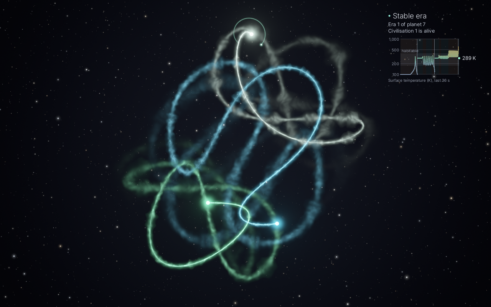
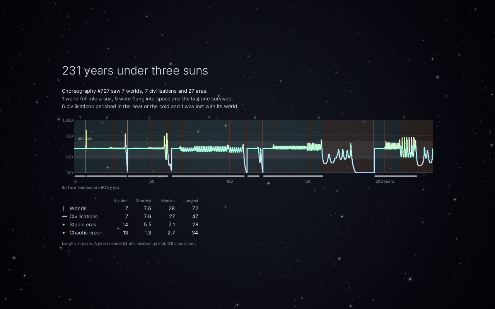

# Moirai

Three bodies, dancing forever.

<p>
  
  
</p>

Real three-body systems are chaotic: almost every configuration falls apart within a few
revolutions, as one body is flung away. Moirai shows long, beautiful three-body dances that look
completely natural, using two tricks that never show on screen:

- **Choreographies** — 385 genuinely stable periodic orbits (figure-eight, Moth I, Butterfly III
  and hundreds of rarer ones). Each showing gets a tiny random kick, so it is a slightly different
  quasi-periodic variant every time, and the whole scene is verified before it starts. Pure,
  untouched Newtonian gravity.
- **Dances** — random triangles kept alive by look-ahead steering. The physics runs about eight
  revolutions ahead of the screen; when that future contains an ejection, a near-collision or a
  pair locking into a dull binary, the engine rewrites it with a nudge typically smaller than
  one part in ten million (energy, momentum and angular momentum stay exactly conserved). Chaos
  amplifies the nudge until the bad future simply never happens.

The name: the Moirai are the three Fates. **Clotho** spins the thread (the renderer drawing the
trails), **Lachesis** measures it (the look-ahead steering), **Atropos** cuts it (the events the
engine prevents).

## Running it

Moirai needs Rust 1.90 or newer ([rustup](https://rustup.rs)) and a GPU with a Vulkan driver
(Mesa's on Linux). It builds without any other libraries: Vulkan, Wayland, X11 and xkbcommon are
loaded when it runs.

```sh
cargo build --release
./target/release/moirai            # full screen, Esc or q to quit
./target/release/moirai --window   # in a window
./target/release/moirai --term     # inside the current terminal pane (Ghostty, kitty, WezTerm)
./target/release/moirai --planet   # with a planet among the suns, and its story after each scene
```

| key | |
|---|---|
| `Esc` / `q` | quit (in a full-screen window opened from a terminal pane: back to the pane) |
| `n` | next scene (while a story is told: end it) |
| `space` | pause |
| `t` | trails: smoke → lines → stardust |
| `c` | next colour palette |
| `p` | planet on or off |
| `f` | full screen or windowed (in a terminal pane: the same scene goes full screen) |

Each scene lasts 12 revolutions of its suns, about 72 s (twice that with the planet shown), and
then fades into the next; `--scene-revs` changes that. See `moirai --help` for all options,
`moirai --list` for the choreographies, and `moirai --snapshot frame.png --scene choreo:2` for a
still.

### Looks

- **Trails**: `--trails smoke` (default): each body sheds glowing plasma, a slim hot jet near
  the body that streams back and widens into soft smoke. As it ages it swells into billowing
  puffs that grow with it, meanders, churns slowly and dissolves. `--trails lines` draws smooth
  glowing threads. `--trails dust` sheds fine twinkling motes that stay close to the path and
  only slowly drift apart; a body circling quickly keeps only about its last loop and a half,
  so close, fast swirls stay clear (after a sudden sharp turn, such as a slingshot, the older
  part of the trail fades out over a second or two instead of vanishing). `t` cycles through
  them while running.
- **Palettes**: the rotation uses the featured palettes `solar`, `moonlight` and `aurora`
  (analogous colours plus one pale member). `ember-ice` and `nebula` are still available:
  `--palette solar` shows only one palette, `--palette solar,nebula` a set, `--palette all`
  everything. `c` cycles the current scene through the rotation.
- **Stars**: about 1800 on a 16:10 frame, with power-law brightness and size, slowly breathing;
  they stay put while scenes fade. `--stars 1.5` brightens them (useful on a dim screen),
  `--stars 0` or `--no-stars` removes them.

### The planet

<p>
  
  
</p>

`p` or `--planet` adds a massless world among the three suns, in the spirit of Trisolaris. The
suns pull it, it pulls nothing, and nothing steers it. Each planet starts on a circular orbit in
the habitable zone of the sun farthest from the other two. When it falls into a sun, is flung
out of the system, or is caught in a scorching orbit close to a sun (over 700 K for a few
seconds, lost in its glare), the next planet starts the same way, so one system shows many
planetary histories; most last a few to a few dozen seconds. While the planet is shown the scene
runs at half speed, so that its orbit can be followed, and the suns' glow is smaller, so that it
does not hide a planet close to its sun.

A readout in the top-right corner follows the planet. The era is **stable** while the planet is
bound to one sun, the others barely disturb it and it is neither boiling nor frozen (180 to
400 K), and **chaotic** otherwise; below it, which era of which planet this is and whether its
civilisation lives. A graph shows the surface temperature over the last half minute on a log
scale from 100 K to 1,000 K (a planet is nearly always out of the picture before it gets colder,
and lost to a sun soon after it gets hotter; beyond that the line runs along the edge), with the
band where a civilisation can live, the eras shaded along the time axis, and a line where one
planet was lost and the next began. The temperature comes from the three suns' light; the
surface responds within a couple of months, like Earth's oceans, so an elliptical orbit has
seasons. It also tints the planet. A civilisation perishes when the seas boil (400 K) or freeze
solid (180 K) for more than a season; the planet carries on, and a new civilisation rises once
the climate has stayed mild for a few planet years.

When a scene ends, its story is told for 30 seconds over the darkened sky: how many years it
lasted, how many worlds, civilisations and eras it saw and how they ended, a timeline of every
world with its temperature, its eras and the lifetimes of its civilisations, and the shortest,
median and longest of each. A year is one orbit of a newborn planet (every planet starts on the
same orbit), about 0.6 s on screen; a scene is about 230 years. `n` ends the story early, and a
scene skipped with `n` tells none. While the story holds still, no frames are drawn at all.
`moirai --snapshot story.png --story` renders one.

`moirai --planet-stats 20` simulates twenty scenes without showing them and prints each one's
story in numbers: its years, its worlds and how they ended, its civilisations and eras, and how
long they lasted.

### In a Ghostty split

Open a split (e.g. `ctrl+shift+o` / `ctrl+shift+e` by default) and run `moirai --term` there;
`f` shows the same scene full screen whenever you want a closer look, and `Esc` returns to the
pane. Frames are rendered on the GPU and shown with the kitty graphics protocol, so the pane
shows real pixels at its native resolution, not text-mode art. They travel through two files in
`/dev/shm` that are mapped once and overwritten in turn (`t=f`); Ghostty answers OK for each
frame before its file is reused, so frames never tear and moirai never runs ahead of the
terminal. Terminals that refuse files get a fresh shared-memory object per frame (`t=s`) or, as
a last resort, base64 data at 10 fps.

Ghostty then has more work per frame than moirai itself: it reads the frame, copies it, uploads
it into a new GPU texture and redraws its window. In a quarter-screen pane (1391×858) at 30 fps
that came to about 19% of one core, against moirai's 6–7%, plus a few percent in GNOME Shell for
compositing. About 8% of Ghostty's share is just redrawing the window 30 times a second, which
any animation in a terminal costs. Frames go out as RGB rather than RGBA, which saves Ghostty
about a tenth. The rest scales with the frame rate and, less, with the pixel count, so the pane
runs at 20 fps by default: a fifth less for Ghostty than 30 fps, and at a quarter of the screen
it looks fine. `--fps 30` gives smoother motion; `--fps 15` saves over a third and `--scale 0.5`
about a quarter (`--scale 0.75` hardly helps). moirai cannot tell when its tab is hidden, so
quit it (`q`) when you will not look at it for a while.

### Cost

Approximate frame times, measured on a Ryzen AI laptop (Radeon 860M) running on battery, with
`--dry-run` on Moth I (one of the busiest scenes) once its trails were fully grown. They cover
render, physics and, for the pane, the copy into the frame file; Ghostty's own work (see above)
is not included.

| output | trails | frame time | CPU (one core) |
|---|---|---|---|
| Ghostty pane, 1280×800 at 20 fps | smoke | 3.9 ms | 4% |
| Ghostty pane, 1280×800 at 20 fps | stardust | 3.4 ms | 4% |
| full screen, 2880×1800 at 60 fps | smoke | 6.4 ms | 6% |
| full screen, 2880×1800 at 60 fps | stardust | 3.7 ms | 6% |
| full screen, 2880×1800 at 60 fps | lines | 4.1 ms | 5% |

Power, measured with the SoC's own reading: with lines, a pane added about 0.1 W (within the
noise) and full screen about 0.7 W (about 1.2 W at the battery; the whole laptop drew 7–8 W at
idle). Smoke and stardust have not been power-measured since their latest rework; smoke is still
the most expensive style. A scene's story costs nothing once it is drawn: while it holds still,
no frames are rendered or sent. Measure your own setup with e.g.
`moirai --term --dry-run 20 --size 1280x800` or `moirai --dry-run 20 --size 2880x1800`.

### As a screensaver (GNOME)

GNOME on Wayland has no screensaver plug-in API, so bind a keyboard shortcut instead: Settings →
Keyboard → View and Customize Shortcuts → Custom Shortcuts → `+`, with the full path of the
binary and the options you like as the command, for example
`/home/you/Documents/Repos/moirai/target/release/moirai --planet` on `Super+Shift+M`. `Esc` or
`q` ends it and `f` turns it into a window. The shortcut runs whatever was built last, so
rebuild after pulling changes.

## How it works

```
crates/moirai-core   physics, Atropos (events), Lachesis (steering), timeline, scenes, planet; no dependencies
crates/moirai        wgpu renderer, window (winit), terminal (kitty graphics) and snapshot outputs
data/                the stable-orbit catalogue
```

- `physics` — Newtonian gravity, adaptive RK4 whose steps land on a fixed time grid, so any
  saved state restarts bit-for-bit (the steering relies on this).
- `events` — flags near-collisions, wide excursions, hard binaries and "frozen" hierarchical
  triples, preferably *before* they happen (Kepler predictions), while the motion is still
  chaotic enough to steer.
- `steer` — tries nudges of 1e-9, 1e-8, … at the earliest still-unseen moment and keeps the
  smallest one whose future is clean.
- `timeline` / `engine` — a background thread keeps each scene computed ahead of the display and
  sleeps otherwise; scenes fade in and out, and with the planet shown each one ends with its
  story.
- `planet` — the restricted four-body problem: inside each step of the stars the planet takes
  its own small steps, reading the stars' positions from that step's dense output, so the stars
  are untouched and steering rewrites recompute the planet too. Its losses and restarts are
  decided ahead of the display like everything else.
- `annals` — the story of a scene's planets, gathered from the planet's samples as they are
  shown: every world, era and civilisation with its span, and the temperature in quarter-year
  slices, which the end-of-scene story draws its timeline from.
- Rendering — each body's trail goes into its own channel of an HDR texture. The trail is cut
  into the longest segments that stay within 0.3 px of the path (few segments, little
  overdraw), and the timeline records how far every body has travelled, so effects can be
  pinned to places on the path. Segments always end at fixed places on the path, so they stay
  the same from frame to frame as the trail slides along. Smoke is shaded per pixel in path
  coordinates (distance along and across the path, at the same scale both ways so that features
  are round, not streaked) from a small tileable 3D noise texture made at start-up: its eddies
  grow with the plume, which swells into puffs and narrows between them, streams back from the
  body, meanders and churns slowly in time. The young smoke, with its fine detail, is drawn at
  full resolution and the older, wider and softer smoke at half resolution. Each segment's
  plume reaches past its ends only as far as the bend there needs rather than a full plume
  width, so far fewer pixels are shaded twice. Lines and smoke use *max* blending (no beads at
  the joints, no blur passes). Stardust motes are seeded by their place on the path, so each is
  the same mote in every frame without particle state; motes smaller than a pixel are drawn a
  pixel wide and correspondingly fainter, which keeps them steady. They fade out by how far the
  path has turned as well as by time. The starfield is drawn once per window size. One
  composite pass adds background, stars, trails and bodies, filmic tone mapping and dithering.
- Text — the readout and the story are glyphs and simple shapes drawn over the finished frame,
  with Inter rasterised once per size into a small atlas (fontdue). While the story holds still
  the engine says so, and neither the window nor the terminal draws a frame.

`cargo test --release` covers orbit closure and conservation, bit-identical restarts,
conservation-preserving nudges, steered runs replaying cleanly, the real-time timeline, and the
terminal input parser (keys versus graphics replies), the smoke noise volume (tiling and
normalisation), how stardust fades by turning, the planet (stable orbits, losses and restarts, a
path that leaves the stars bit-for-bit unchanged and repeats exactly), and the story of its
worlds, eras and civilisations and how it is laid out.

## Credits

The readout is set in [Inter](https://rsms.me/inter/) by Rasmus Andersson (SIL Open Font
License 1.1, see `crates/moirai/assets/Inter-LICENSE.txt`).

Stable orbits: I. Hristov, R. Hristova and K. Tanikawa, *An extensive search for stable periodic
orbits of the equal-mass zero angular momentum three-body problem* (2025),
[arXiv:2510.22802](https://arxiv.org/abs/2510.22802), data at
<https://db2.fmi.uni-sofia.bg/3bodystab971/>. Orbit names from M. Šuvakov and V. Dmitrašinović,
*Three classes of Newtonian three-body planar periodic orbits*, PRL 110 (2013).
