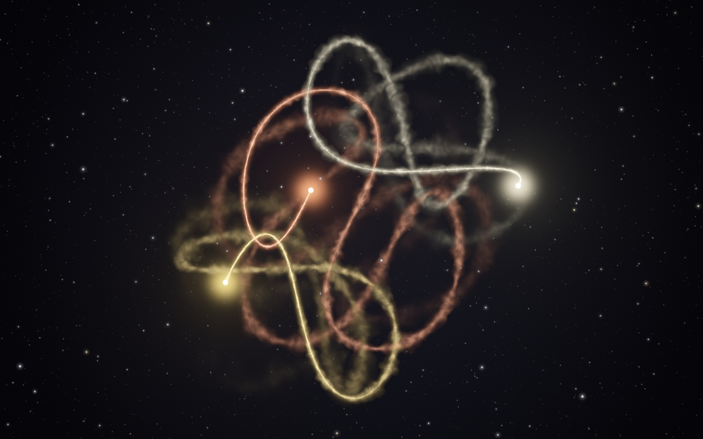
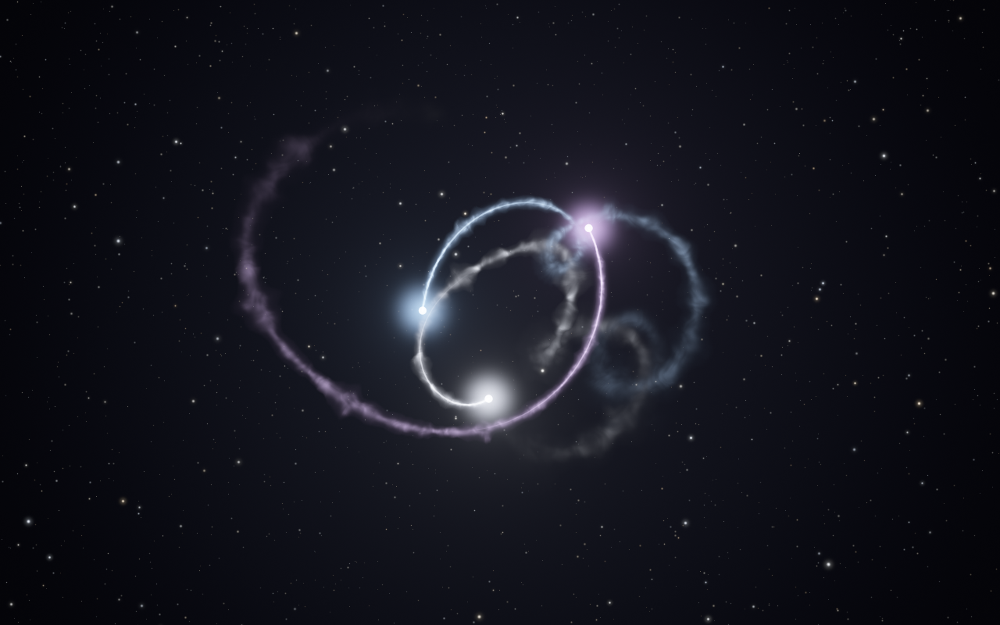

# Moirai

Three bodies, dancing forever.

<p>
  
  
</p>

Real three-body systems are chaotic: almost every configuration falls apart within a few
revolutions, as one body is flung away. Moirai shows long, beautiful three-body dances that look
completely natural, using two tricks that never show on screen:

- **Choreographies** — 385 genuinely stable periodic orbits (figure-eight, Moth I, Butterfly III
  and hundreds of rarer ones). Each showing gets a tiny random kick, so it is a slightly different
  quasi-periodic variant every time, and the whole scene is verified before it starts. Pure,
  untouched Newtonian gravity.
- **Dances** — random triangles kept alive by look-ahead steering. The physics runs about eight
  revolutions ahead of the screen; when that future contains an ejection, a near-collision or a
  pair locking into a dull binary, the engine rewrites it with a nudge typically smaller than
  one part in ten million (energy, momentum and angular momentum stay exactly conserved). Chaos
  amplifies the nudge until the bad future simply never happens.

The name: the Moirai are the three Fates. **Clotho** spins the thread (the renderer drawing the
trails), **Lachesis** measures it (the look-ahead steering), **Atropos** cuts it (the events the
engine prevents).

## Running it

```sh
cargo build --release
./target/release/moirai            # fullscreen, Esc or q to quit
./target/release/moirai --window   # in a window
./target/release/moirai --term     # inside the current terminal pane (Ghostty, kitty, WezTerm)
```

Keys: `Esc`/`q` quit · `n` next scene · `space` pause · `t` smoke → lines → stardust · `c` next palette.
See `moirai --help` for all options, `moirai --list` for the choreographies, and
`moirai --snapshot frame.png --scene choreo:2` for a still.

### Looks

- **Trails**: `--trails smoke` (default): each body sheds glowing plasma, a slim hot jet near
  the body that streams back and widens into soft smoke. As it ages it swells into billowing
  puffs that grow with it, meanders, churns slowly and dissolves. `--trails lines` draws smooth
  glowing threads. `--trails dust` sheds fine twinkling motes that stay close to the path and
  only slowly drift apart; a body circling quickly keeps only about its last loop and a half,
  so close, fast swirls stay clear. `t` cycles through them while running.
- **Palettes**: the rotation uses the featured palettes `solar`, `moonlight` and `aurora`
  (analogous colours plus one pale member). `ember-ice` and `nebula` are still available:
  `--palette solar` shows only one palette, `--palette solar,nebula` a set, `--palette all`
  everything. `c` cycles the current scene through the rotation.
- **Stars**: about 1800 on a 16:10 frame, with power-law brightness and size, slowly breathing;
  they stay put while scenes fade. `--stars 1.5` brightens them (useful on a dim screen),
  `--stars 0` or `--no-stars` removes them.

### In a Ghostty split

Open a split (e.g. `ctrl+shift+o` / `ctrl+shift+e` by default) and run `moirai --term` there.
Frames are rendered on the GPU and shown with the kitty graphics protocol, so the pane shows real
pixels at its native resolution, not text-mode art. They travel through two files in `/dev/shm`
that are mapped once and overwritten in turn (`t=f`); Ghostty answers OK for each frame before
its file is reused, so frames never tear and moirai never runs ahead of the terminal. Terminals
that refuse files get a fresh shared-memory object per frame (`t=s`) or, as a last resort,
base64 data at 10 fps.

Ghostty additionally reads each frame and uploads it to its own GPU texture. To save battery,
lower `--fps` (the motion is slow; 20–24 fps looks fine) or `--scale 0.75`. moirai cannot tell
when its tab is hidden, so quit it (`q`) when you will not look at it for a while.

### Cost

Approximate frame times, measured on a Ryzen AI laptop (Radeon 860M) running on battery, with
`--dry-run` on Moth I (one of the busiest scenes) once its trails were fully grown. They cover
render, physics and, for the pane, the copy into the frame file; Ghostty's own work is not
included.

| output | trails | frame time | CPU (one core) |
|---|---|---|---|
| Ghostty pane, 1280×800 at 30 fps | smoke | 4.9 ms | 6% |
| Ghostty pane, 1280×800 at 30 fps | stardust | 3.5 ms | 6% |
| full screen, 2880×1800 at 60 fps | smoke | 9.4 ms | 5% |
| full screen, 2880×1800 at 60 fps | stardust | 3.9 ms | 7% |
| full screen, 2880×1800 at 60 fps | lines | 4.0 ms | 5% |

Power, measured with the SoC's own reading: with lines, a pane added about 0.1 W (within the
noise) and full screen about 0.7 W (about 1.2 W at the battery; the whole laptop drew 7–8 W at
idle). Smoke and stardust have not been power-measured since their latest rework. The smoke
is the expensive style for now: it is drawn at full resolution, with overlapping plumes around
every segment, which leaves room to optimise. Measure your own setup with e.g.
`moirai --term --dry-run 20 --size 1280x800` or `moirai --dry-run 20 --size 2880x1800`.

### As a screensaver (GNOME)

GNOME on Wayland has no screensaver plug-in API, so bind a keyboard shortcut instead:
Settings → Keyboard → View and Customize Shortcuts → Custom Shortcuts → `+`, with the command set
to the full path of the binary (e.g. `/home/you/Documents/Repos/moirai/target/release/moirai`).

## How it works

```
crates/moirai-core   physics, Atropos (events), Lachesis (steering), timeline, scenes; no dependencies
crates/moirai        wgpu renderer, window (winit), terminal (kitty graphics) and snapshot outputs
data/                the stable-orbit catalogue
```

- `physics` — Newtonian gravity, adaptive RK4 whose steps land on a fixed time grid, so any
  saved state restarts bit-for-bit (the steering relies on this).
- `events` — flags near-collisions, wide excursions, hard binaries and "frozen" hierarchical
  triples, preferably *before* they happen (Kepler predictions), while the motion is still
  chaotic enough to steer.
- `steer` — tries nudges of 1e-9, 1e-8, … at the earliest still-unseen moment and keeps the
  smallest one whose future is clean.
- `timeline` / `engine` — a background thread keeps each scene computed ahead of the display
  and sleeps otherwise; scenes fade in and out.
- Rendering — each body's trail goes into its own channel of an HDR texture. The trail is cut
  into the longest segments that stay within 0.3 px of the path (few segments, little
  overdraw), and the timeline records how far every body has travelled, so effects can be
  pinned to places on the path. Segments always end at fixed places on the path, so they stay
  the same from frame to frame as the trail slides along. Smoke is shaded per pixel in path
  coordinates (distance along and across the path, at the same scale both ways so that
  features are round, not streaked) from a small tileable 3D noise texture made at start-up:
  its eddies grow with the plume, which swells into puffs and narrows between them, streams
  back from the body, meanders and churns slowly in time. Lines and smoke use *max* blending
  (no beads at the joints, no blur passes). Stardust motes are seeded by their place on the
  path, so each is the same mote in every frame without particle state; motes smaller than a
  pixel are drawn a pixel wide and correspondingly fainter, which keeps them steady. They fade
  out by how far the path has turned as well as by time. The starfield is drawn once per
  window size. One composite pass adds background, stars, trails and bodies, filmic tone
  mapping and dithering.

`cargo test --release` covers orbit closure and conservation, bit-identical restarts,
conservation-preserving nudges, steered runs replaying cleanly, the real-time timeline, and the
terminal input parser (keys versus graphics replies), the smoke noise volume (tiling and
normalisation) and how stardust fades by turning.

## Credits

Stable orbits: I. Hristov, R. Hristova and K. Tanikawa, *An extensive search for stable periodic
orbits of the equal-mass zero angular momentum three-body problem* (2025),
[arXiv:2510.22802](https://arxiv.org/abs/2510.22802), data at
<https://db2.fmi.uni-sofia.bg/3bodystab971/>. Orbit names from M. Šuvakov and V. Dmitrašinović,
*Three classes of Newtonian three-body planar periodic orbits*, PRL 110 (2013).
